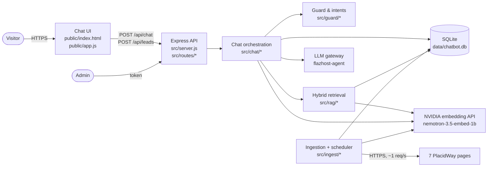
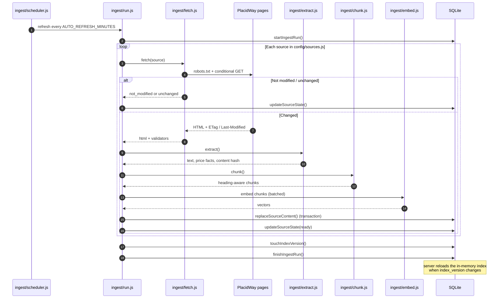
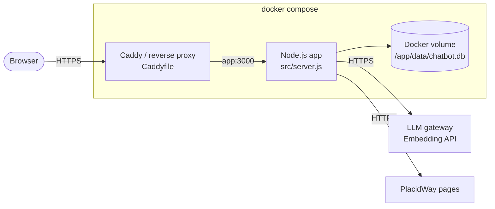

# Architecture

This document reflects the code after the chat-pipeline split
(`src/chat/pipeline.js` is an orchestrator; each step lives in its own module).

## 1. System context



Only the seven allow-listed PlacidWay pages are fetched. The LLM never sees
pages directly; it only sees retrieved passages and deterministic price facts.

## 2. Module layers and dependency direction

Dependencies point downward. Lower layers never import upper layers.

```mermaid
flowchart TB
    subgraph L1["HTTP layer"]
        Server["server.js"]
        ChatRoutes["routes/chat.js"]
        AdminRoutes["routes/admin.js"]
        Static["public/*"]
    end

    subgraph L2["Orchestration"]
        Pipeline["chat/pipeline.js"]
    end

    subgraph L3["Chat domain modules"]
        Intents["chat/intents.js"]
        Rewrite["chat/rewrite.js"]
        Retrieval["chat/retrieval.js"]
        NoContext["chat/no-context.js"]
        NoLlm["chat/no-llm.js"]
        Answer["chat/answer.js"]
        Fallbacks["chat/fallbacks.js"]
        Prices["chat/prices.js"]
        Context["chat/context.js"]
        Respond["chat/respond.js"]
        Text["chat/text.js"]
    end

    subgraph L4["Capabilities"]
        Guard["guard/*"]
        Rag["rag/*"]
        Llm["llm/*"]
        Ingest["ingest/*"]
    end

    subgraph L5["Data and runtime"]
        Store[("store/db.js<br/>SQLite")]
        Config["config.js"]
        Logger["util/logger.js"]
    end

    L1 --> L2
    L2 --> L3
    L3 --> L4
    L4 --> L5
```



`chat/pipeline.js` only wires the steps together:

| Step | Module |
|---|---|
| Early deterministic replies | `chat/intents.js` |
| Follow-up / non-English rewrite | `chat/rewrite.js` |
| Embedding, search, price facts, relevance | `chat/retrieval.js` |
| No-context routing | `chat/no-context.js` |
| Deterministic answer without LLM | `chat/no-llm.js` |
| LLM call, validation outcome, fallbacks | `chat/answer.js` |
| Fallback content | `chat/fallbacks.js` |
| Price ranking and price replies | `chat/prices.js` |
| History/entity context | `chat/context.js` |
| Persist + disclaimer | `chat/respond.js` |

## 3. Chat request flow

```mermaid
sequenceDiagram
    autonumber
    participant V as Visitor
    participant UI as Chat UI
    participant API as routes/chat.js
    participant P as chat/pipeline.js
    participant G as guard/intent.js
    participant RW as chat/rewrite.js
    participant RT as chat/retrieval.js
    participant IDX as rag/index.js
    participant DB as SQLite
    participant EMB as Embedding API
    participant LLM as LLM gateway
    participant VAL as llm/validate.js

    V->>UI: question
    UI->>API: POST /api/chat {sessionId, message}
    API->>API: zod validation + rate limit
    API->>P: handleChat()

    P->>DB: ensureConversation / getHistory
    P->>G: resolveLanguage + detectIntent

    alt Deterministic intent
        P->>DB: save user + assistant message
        P-->>UI: greeting / smalltalk / catalog / booking / medical / out-of-scope / currency
    else Needs retrieval
        P->>RW: rewrite follow-up or non-English query
        P->>RT: retrieveContext()
        RT->>EMB: embed query
        RT->>IDX: BM25 + cosine + RRF
        IDX->>DB: chunks + sources + price_facts
        RT->>RT: relevance gate + price facts
        Note over P,DB: If the last ingest is older than STALE_REFRESH_MINUTES,<br/>a background refresh starts; this request is not blocked

        alt No relevant context
            P->>LLM: classify ambiguous intent
            P->>DB: save messages + unanswered log
            P-->>UI: catalog / clarify / smalltalk / not-found
        else Relevant context found
            P->>LLM: grounded prompt → JSON answer
            LLM-->>P: answer draft
            P->>VAL: citations, numbers, medical advice, prompt leak
            VAL-->>P: validated answer or fallback
            P->>DB: save user + assistant message
            P-->>UI: answer + sources + disclaimer + lead prompt
        end
    end
```

Important guarantees in this flow:

- Guardrail intents (booking, medical, out-of-scope, currency) never reach the
  free-form model.
- The relevance gate runs before the LLM, so unsupported questions fail closed.
- Every currency amount in the answer must appear in the cited context.
- Sources are rendered server-side from `S#` IDs; raw URLs from the model are
  stripped.

## 4. Ingestion and refresh flow



A failed source never wipes its previous content: `replaceSourceContent()` runs
in a transaction only after extraction and embedding succeed.

Two things can start this flow:

- the scheduler, every `AUTO_REFRESH_MINUTES`;
- `maybeRefreshInBackground()`, called by `/api/meta` and `/api/chat`, when the
  last run is older than `STALE_REFRESH_MINUTES`. It returns immediately and the
  current index serves the request. A single-flight flag and a 60-second retry
  cooldown prevent overlapping crawls.

## 5. Deployment topology



- Compose forces `PORT=3000` inside the container; Caddy exposes `80/443`.
- `data/` is a persistent volume: it holds SQLite plus WAL files.
- The scheduler runs inside the app process, so a single replica owns refresh.
  Running multiple replicas would duplicate ingest work; use one writer or move
  refresh to a separate job before scaling out.
