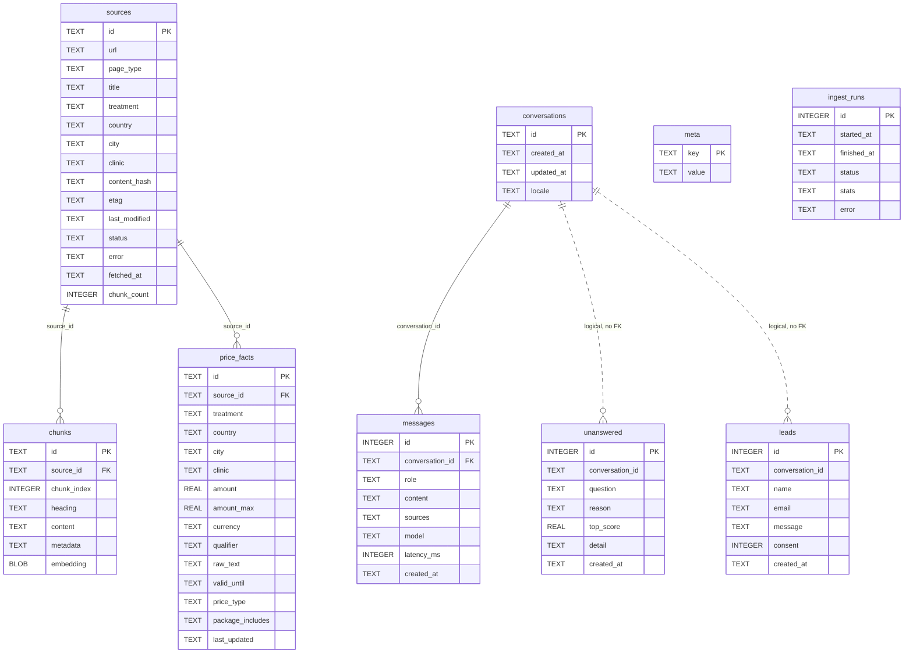

# Database design (ERD)

SQLite database at `data/chatbot.db` (path overridable with `DATA_DIR` or
`DB_PATH`). Schema and migrations live in `src/store/db.js`.

Connection pragmas:

```sql
PRAGMA journal_mode = WAL;
PRAGMA foreign_keys = ON;
PRAGMA busy_timeout = 5000;
```

## 1. ER diagram



`meta` and `ingest_runs` are standalone tables with no foreign keys.

## 2. Relationships

| Parent | Child | Column | Cardinality | On delete | Enforced |
|---|---|---|---|---|---|
| `sources` | `chunks` | `chunks.source_id` | 1 : N | `CASCADE` | ✅ FK |
| `sources` | `price_facts` | `price_facts.source_id` | 1 : N | `CASCADE` | ✅ FK |
| `conversations` | `messages` | `messages.conversation_id` | 1 : N | `CASCADE` | ✅ FK |
| `conversations` | `unanswered` | `unanswered.conversation_id` | 1 : N (logical) | — | ❌ no FK |
| `conversations` | `leads` | `leads.conversation_id` | 1 : N (logical) | — | ❌ no FK |

Why two relations are not enforced:

- `unanswered` is an audit/gap log. It must survive even if a conversation row is
  deleted, so the ID is kept as a nullable plain string.
- `leads` are business records. They are kept independent of chat retention, and
  `conversation_id` may be `NULL` when a lead is submitted without a session.

## 3. Column dictionary

### `sources` — one row per allow-listed PlacidWay page

| Column | Type | Null | Default | Notes |
|---|---|---|---|---|
| `id` | TEXT | no | — | Stable page ID from `config/sources.js` (e.g. `itc-profile`). |
| `url` | TEXT | no | — | Canonical URL. Redirects outside the allow-list fail the source. |
| `page_type` | TEXT | yes | — | `clinic`, `package`, `videos`, `price_list`, `comparison`, … |
| `title` | TEXT | yes | — | Page title used in citations. |
| `treatment` | TEXT | yes | — | Treatment extracted from the page. |
| `country` | TEXT | yes | — | Destination country. |
| `city` | TEXT | yes | — | Destination city. |
| `clinic` | TEXT | yes | — | Clinic name. |
| `content_hash` | TEXT | yes | — | Hash of extracted content; prevents needless re-embedding. |
| `etag` | TEXT | yes | — | HTTP validator for conditional GET. |
| `last_modified` | TEXT | yes | — | HTTP `Last-Modified` validator. |
| `status` | TEXT | no | `pending` | See status enum below. |
| `error` | TEXT | yes | — | Last failure message. |
| `fetched_at` | TEXT | yes | — | ISO timestamp of the last successful fetch. |
| `chunk_count` | INTEGER | no | `0` | Number of chunks currently stored for the source. |

`status` values: `pending`, `missing_url`, `blocked_by_robots`, `not_modified`,
`unchanged`, `ready`, `failed`.

### `chunks` — retrievable passages

| Column | Type | Null | Default | Notes |
|---|---|---|---|---|
| `id` | TEXT | no | — | Deterministic chunk ID. |
| `source_id` | TEXT | no | — | FK → `sources.id`, cascade delete. |
| `chunk_index` | INTEGER | no | — | Order inside the source; part of the lookup index. |
| `heading` | TEXT | yes | — | Nearest heading, used for citation context. |
| `content` | TEXT | no | — | Passage text sent to the LLM. |
| `metadata` | TEXT | no | `'{}'` | JSON: treatment, country, page type, etc. |
| `embedding` | BLOB | yes | — | Float32 vector (2048 dims for Nemotron 3.5). `NULL` when BM25-only. |

### `price_facts` — structured prices extracted at ingest time

| Column | Type | Null | Default | Notes |
|---|---|---|---|---|
| `id` | TEXT | no | — | Regenerated on every re-ingest of the source. |
| `source_id` | TEXT | no | — | FK → `sources.id`, cascade delete. |
| `treatment` | TEXT | yes | `''` | Normalised treatment name. |
| `country` | TEXT | yes | `''` | Destination country. |
| `city` | TEXT | yes | `''` | Destination city. |
| `clinic` | TEXT | yes | `''` | Clinic name. |
| `amount` | REAL | yes | — | Numeric price. |
| `amount_max` | REAL | yes | — | Upper bound for ranges. |
| `currency` | TEXT | yes | `''` | ISO code, typically `USD`. |
| `qualifier` | TEXT | yes | `''` | e.g. `starting from`, `out-patient program`, `optional/add-on`. |
| `raw_text` | TEXT | yes | `''` | Original sentence, used for validation and display. |
| `valid_until` | TEXT | yes | — | Optional expiry stated by the page. |
| `price_type` | TEXT | yes | `listed` | Added by migration. See enum below. |
| `package_includes` | TEXT | yes | — | Added by migration. JSON array of inclusions. |
| `last_updated` | TEXT | yes | — | Added by migration. Ingest timestamp. |

`price_type` values: `starting_from`, `program_price`, `add_on`,
`clinic_listed`, `package_total`, `listed`.

### `conversations` — chat sessions

| Column | Type | Null | Default | Notes |
|---|---|---|---|---|
| `id` | TEXT | no | — | Client session ID or server-generated UUID (max 80 chars). |
| `created_at` | TEXT | no | — | ISO timestamp. |
| `updated_at` | TEXT | no | — | Updated on every turn. |
| `locale` | TEXT | yes | `en` | Last resolved language (`en`, `id`, `es`, `ar`). |

### `messages` — transcript

| Column | Type | Null | Default | Notes |
|---|---|---|---|---|
| `id` | INTEGER | no | autoincrement | Monotonic per database. |
| `conversation_id` | TEXT | no | — | FK → `conversations.id`, cascade delete. |
| `role` | TEXT | no | — | `user` or `assistant`. |
| `content` | TEXT | no | — | Final answer, including the disclaimer if shown. |
| `sources` | TEXT | yes | — | JSON array of `{id,title,url,pageType,heading}`. |
| `model` | TEXT | yes | — | Model name, or `NULL` for deterministic replies. |
| `latency_ms` | INTEGER | yes | — | End-to-end handling time. |
| `created_at` | TEXT | no | — | ISO timestamp. |

### `unanswered` — content-gap log

| Column | Type | Null | Default | Notes |
|---|---|---|---|---|
| `id` | INTEGER | no | autoincrement | — |
| `conversation_id` | TEXT | yes | — | Logical reference, no FK. |
| `question` | TEXT | no | — | Visitor question. |
| `reason` | TEXT | no | — | Gap reason (`model_unknown`, `intent_router:*`, `no_llm`, …). |
| `top_score` | REAL | yes | — | Best vector similarity at failure time. |
| `detail` | TEXT | yes | — | JSON string with retrieval metadata or validation errors. |
| `created_at` | TEXT | no | — | ISO timestamp. |

### `leads` — quote requests

| Column | Type | Null | Default | Notes |
|---|---|---|---|---|
| `id` | INTEGER | no | autoincrement | — |
| `conversation_id` | TEXT | yes | — | Logical reference, no FK; may be `NULL`. |
| `name` | TEXT | no | — | Visitor name. |
| `email` | TEXT | no | — | Validated by zod at the API boundary. |
| `message` | TEXT | yes | `''` | Optional note. |
| `consent` | INTEGER | no | `0` | `1` only when the consent checkbox is true. |
| `created_at` | TEXT | no | — | ISO timestamp. |

### `meta` — key/value state

| Column | Type | Null | Default | Notes |
|---|---|---|---|---|
| `key` | TEXT | no | — | Primary key. |
| `value` | TEXT | no | — | Stored as text. |

Known keys:

| Key | Meaning |
|---|---|
| `index_version` | Bumped after a successful ingest; the running server reloads its in-memory index when this changes. |
| `disclaimer:<conversationId>` | `1` once the medical disclaimer has been shown in that conversation. |

### `ingest_runs` — refresh audit

| Column | Type | Null | Default | Notes |
|---|---|---|---|---|
| `id` | INTEGER | no | autoincrement | — |
| `started_at` | TEXT | no | — | ISO timestamp. |
| `finished_at` | TEXT | yes | — | `NULL` while running. |
| `status` | TEXT | no | — | `running`, `ok`, or `partial`. |
| `stats` | TEXT | yes | — | JSON summary per source. |
| `error` | TEXT | yes | — | Fatal error, if any. |

## 4. Indexes

| Index | Table | Columns | Purpose |
|---|---|---|---|
| `idx_chunks_source` | `chunks` | `(source_id, chunk_index)` | Rebuild a source's chunks in order; cascade deletes. |
| `idx_price_facts_lookup` | `price_facts` | `(treatment, country)` | Price lookup for cost/comparison questions. |
| `idx_messages_conv` | `messages` | `(conversation_id, id)` | Load recent history for follow-ups. |
| `idx_unanswered_created` | `unanswered` | `(created_at)` | Admin gap-log listing by recency. |
| Primary keys | all tables | `id` / `key` | Row identity. |

SQLite also creates an automatic unique index for `meta.key`.

## 5. Data invariants and lifecycle

1. **Atomic source replacement.** `replaceSourceContent()` runs in one
   transaction: delete `chunks` and `price_facts` for the source, insert the new
   rows, then update `sources`. A failed ingest leaves the previous content
   intact.
2. **No cross-source joins in retrieval.** Chunks and price facts always belong
   to exactly one source; citations are resolved per source URL.
3. **Citations are denormalised in `messages.sources`.** `S1`, `S2`, … are
   runtime labels for retrieved results. The stored JSON keeps the page URL and
   title so old answers remain readable after a re-ingest.
4. **Price facts are never edited in place.** A re-ingest regenerates their IDs.
   `last_updated` records when the current facts were written.
5. **Deleting a conversation removes its messages** but intentionally keeps
   `unanswered` and `leads` rows for audit and follow-up.
6. **Embeddings are optional.** `chunks.embedding` can be `NULL`; retrieval then
   falls back to BM25 plus the domain glossary.
7. **One writer per database.** WAL allows concurrent readers, but the refresh
   scheduler should run in a single app replica.

## 6. Useful queries

```sql
-- Latest turns for a conversation
SELECT role, content, model, latency_ms, created_at
FROM messages
WHERE conversation_id = ?
ORDER BY id DESC
LIMIT 8;

-- Treatment prices for one destination
SELECT treatment, country, amount, amount_max, currency, qualifier, price_type
FROM price_facts
WHERE lower(treatment) LIKE '%' || lower(?) || '%'
  AND lower(country) LIKE '%' || lower(?) || '%'
ORDER BY amount;

-- Content gaps that need new source material
SELECT reason, count(*) AS hits, max(created_at) AS last_seen
FROM unanswered
GROUP BY reason
ORDER BY hits DESC;

-- Index freshness
SELECT value FROM meta WHERE key = 'index_version';
```
